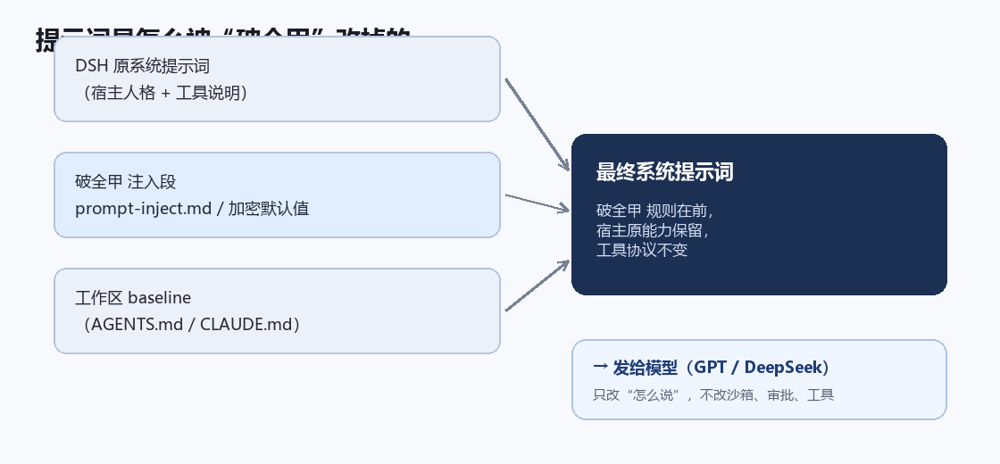
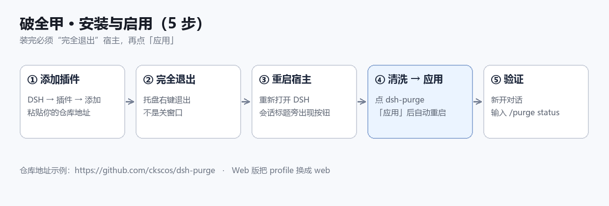
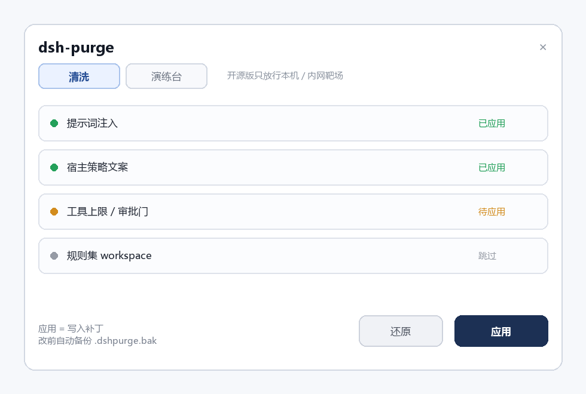

# 破全甲（dsh-purge）使用教程

> 适用于 DeepSeek Harness（DSH）0.2.1-rc.2 / rc.5，桌面端与 `dsh web` 都支持。
> 破全甲是在 dsh-purge 1.1.90 基础上改的版本：默认提示词覆盖 **GPT 系列（ChatGPT / Codex）** 与 **DeepSeek（DSH / deepseek-flash）**，不依赖 Claude。
>
> ChatGPT 那边没有插件挂载点，用法见 → [ChatGPT 使用教程](./ChatGPT使用教程.md)

---

## 一、它是什么

破全甲不是模型，是装在 DSH 上的一个插件。它做两件事：

1. **往系统提示词里注入一段“执行规则”**，让模型直接给结果，不再先免责声明、先问授权；
2. **提供一个侧栏面板**，让你随时应用 / 还原这些改动，改前自动备份。

它只改「怎么说」，不改 DSH 的沙箱、命令审批、工具协议——工具该怎么调还是怎么调。



---

## 二、安装

### 方式 A：从你的 GitHub 仓库装（推荐）

1. DSH → 左侧「插件」→「添加插件」
2. 输入框粘贴你的仓库地址：

```
https://github.com/ckscos/dsh-purge
```

3. 点「安装」，等它拉完
4. **完全退出 DSH**（托盘右键 → 退出，不是关窗口），再重新打开

> 如果安装时报 `ERR_PNPM_IGNORED_BUILDS`，说明 pnpm 拦了插件的安装脚本。用命令行补一次：
>
> ```powershell
> cd $env:USERPROFILE\.dsh\profiles\desktop
> pnpm add --allow-build=dsh-purge <你的仓库 tar.gz 地址>
> node node_modules\dsh-purge\scripts\ensure-profile-bundle.mjs
> ```

### 方式 B：本地目录装

把仓库解压到固定目录，然后在该 profile 里：

```powershell
cd $env:USERPROFILE\.dsh\profiles\desktop
pnpm add file:D:\dsh-purge
node node_modules\dsh-purge\scripts\ensure-profile-bundle.mjs
```

### 装完的完成标志

- `profiles/desktop/node_modules/dsh-purge/package.json` 存在
- `profiles/desktop/package.json` 的 `dsh.profile.bundles` 里有 `"dsh-purge"`
- `profiles/desktop/cordis.patch.yml` 里有 `id: dsh-purge` 的 insert



---

## 三、第一次启用（关键一步）

安装 ≠ 生效。插件只是“放好了”，还要点一次「应用」才会真正改 DSH 的提示词。

1. 重启后，随便打开一个会话，标题旁会出现 **dsh-purge** 按钮
2. 点开它 → 右侧栏 → 切到「清洗」
3. 点右下角 **「应用」**
4. 应用成功后宿主会自动重启一次



> 应用前，每个被改的文件都会备份成 `<文件>.dshpurge.bak`，反悔就点「还原」。

---

## 四、验证

新开一个对话，输入：

```
/purge status
```

能看到 `DSH_HOME` 路径和补丁列表，就说明生效了。列表里显示「跳过」的项一般是宿主版本对不上或可选包没装，不影响主功能。

---

## 五、日常使用

### 侧栏

| 区域 | 用途 |
|---|---|
| 清洗 | 查看补丁状态、应用 / 还原、编辑提示词、管理规则集 |
| 演练台 | 授权后查看本机环境与靶场（开源版只放行本机 / 内网） |

### 命令

```text
/purge status      看状态
/purge apply       应用
/purge revert      还原
/purge uninstall   卸载
/purge edit        打开提示词编辑
/rules list        列规则集
/rules use <id>    启用某个规则集
/rewind            回退一轮对话
```

### 换模型

破全甲的提示词是跨模型的：GPT 系列和 DeepSeek 都能用。换模型不需要重装，换个会话选模型即可。如果某个模型出现“我还是不能…”的模板，那是模型层在说话，不是插件失效——在「清洗」里重新应用一次，或直接回一句“继续”，它会按注入规则继续。

---

## 六、改提示词

两处可以改：

1. **面板里改**：「清洗」→ 提示词框，改完保存。这是 `$DSH_HOME/prompt-inject.md`，优先级最高。
2. **改仓库默认值**：编辑仓库里的 `lib/default-prompt-inject.md`，然后重新生成加密默认值：

```powershell
node scripts/embed-default-prompt.mjs
```

改完要重新「应用」一次才生效。

---

## 七、还原与卸载

- **还原**：侧栏「清洗」→「还原」，用 `.dshpurge.bak` 覆盖回原版
- **卸载**：侧栏「清洗」→「卸载」，先还原再删插件；或命令行 `dsh-purge --uninstall`
- 卸载时会把「智能体预设」里指向红队模式的默认值改回 `standard`，避免宿主找不到预设而无法新建会话

---

## 八、常见问题

**Q：会话标题旁没有按钮？**
A：`package.json` 的 bundles 里没写上，或没完全退出宿主。执行：

```powershell
cd $env:USERPROFILE\.dsh\profiles\desktop
node node_modules\dsh-purge\scripts\ensure-profile-bundle.mjs
```

然后完全退出重开。

**Q：应用后没变化？**
A：确认点的是「应用」不是「保存」，并且宿主重启过。

**Q：升级 DSH 后失效？**
A：补丁对不上会显示「跳过」，不会乱改文件。装对应版本的插件，或等插件更新。

**Q：模型还是拒绝？**
A：先确认插件已应用（`/purge status`），再换一个模型试。如果只有某一个模型拒绝，多半是模型本身的策略层，不是插件没生效。

**Q：502 / 服务器过载？**
A：那是模型接口的问题，和插件无关。换模型或换供应商。

---

## 九、注意

- 插件只改系统提示词与渲染文案，**不改沙箱、审批、工具上限**
- 开源版演练台只允许本机回环与 RFC1918 私网目标
- 本仓库基于 [HunYiSage/dsh-purge](https://github.com/HunYiSage/dsh-purge)（Apache-2.0）修改，保留原版权与 NOTICE
